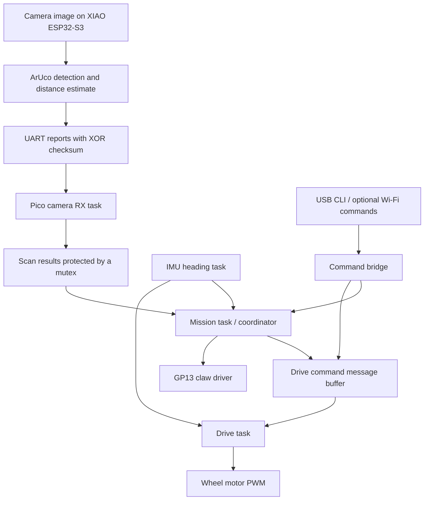

# INF2004 Mobile Pick-and-Place Robot

This project uses a Raspberry Pi Pico W running **µT-Kernel 3 SMP**, an ESP32-S3 XIAO camera, an IMU, a differential-drive chassis and a GP13 claw. Its intended mission is to find an ArUco-marked pickup block, approach and grip it, locate a delivery marker, release the block and reverse before searching again.

This README and the [logic and evidence walkthrough](docs/LOGIC_AND_EVIDENCE.md) explain the existing implementation. They were prepared after the assessed demonstration against source commit **`731bea5857c92889c5e1f7e7ed64f12f70f0c08a`**. They do not introduce firmware changes or new hardware-test results. The source revision is a reference for the explanations; the exact binaries flashed for the demonstration have not been independently identified here.

## Demonstration outcome

The assessed demonstration did **not** establish consistent pickup performance. According to the team's retrospective account, four runs were attempted. One run achieved two successful block pickups. In the other three runs, the robot repeatedly turned while searching for a pickup object. This account does not establish two completed deliveries or a completed mission.

The team had tested the full flow successfully before the demonstration, and [Embedded Demo.MOV](demo%20video/Embedded%20Demo.MOV) is an **earlier successful test recording**, not the assessed demonstration. The cause of the unreliable detections during assessment remains unresolved. The earlier success is evidence of operation in that earlier setup, not evidence of repeatability across the four assessed runs.

During assessment, the professor highlighted the need to see the camera's live image rather than relying only on detection messages. This is a valid limitation of the development process: the team could not directly check the image framing, marker visibility and possible occlusion at the time the failure occurred. A live feed or captured frames under the failing conditions would help distinguish camera-positioning issues from detection, communication and control issues. That diagnostic capability is not implemented in the submitted application.

## Reading guide

| Question | Where to read |
|---|---|
| How does the complete mission work? | [Mission walkthrough](docs/LOGIC_AND_EVIDENCE.md#mission-walkthrough) |
| Why does the robot search in 15-degree steps, and why can it circle repeatedly? | [Search strategy and its limitation](docs/LOGIC_AND_EVIDENCE.md#search-strategy-and-its-limitation) |
| What do image coordinates, distance and mapped bearings mean? | [Vision measurements](docs/LOGIC_AND_EVIDENCE.md#vision-measurements) |
| What does each task own, and how are the cores used? | [RTOS tasks and communication](docs/LOGIC_AND_EVIDENCE.md#rtos-tasks-and-communication) |
| What do the logs actually demonstrate? | [Logs and evidence](docs/LOGIC_AND_EVIDENCE.md#logs-and-evidence) |
| What worked, what is uncertain, and what should have been planned earlier? | [Limitations and lessons](docs/LOGIC_AND_EVIDENCE.md#limitations-and-lessons) |

## Architecture



The Pico mission uses typed scan records and µT-Kernel synchronization. The camera does not command wheel motion. The mission owns the sequence, and the drive task owns runtime wheel PWM. The claw is controlled directly by the mission and permitted manual-command handlers; there is no separate claw task in this build.

The Pico runs µT-Kernel. The separate XIAO firmware uses ESP-IDF and its FreeRTOS task APIs. These are different processors and firmware images.

## Active source and repository layout

The mission entry point is `usermain()` in [integration/main.c](integration/main.c). The kernel build includes it through [robot_arm_app.c](third_party/mtk3smp-rp2040/app_program/robot_arm_app.c). Despite the repository's historical `robot-arm` name, this active mission controls the **mobile car and single claw**. The earlier six-servo PCA9685 arm and its `MovJ()` API are not the active mission described here.

| Location | Purpose |
|---|---|
| [integration/main.c](integration/main.c) | Mission state machine, camera UART parsing, scan storage, drive task, mapping and recovery |
| [integration/cli_bridge.c](integration/cli_bridge.c) | Operator commands, start/reset rules and status reporting |
| [integration/remote_cmd.c](integration/remote_cmd.c) | Wi-Fi command input filtering and dispatch through the shared CLI |
| [components/drive](components/drive) | Wheel PWM, gyro-assisted turns and GP13 claw |
| [components/imu/imu_heading.c](components/imu/imu_heading.c) | Gyro initialization, calibration, sampling and relative heading |
| [components/cli](components/cli) | Pure C command parser, line editor and µT-Kernel CLI task |
| [xiao_vision](xiao_vision) | Separate ESP32-S3 camera firmware |
| [third_party/mtk3smp-rp2040](third_party/mtk3smp-rp2040) | Course kernel port, drivers and Pico firmware build |
| [test cases](test%20cases) | Existing JSON/CSV test register |
| [tools](tools) | Laptop-side Wi-Fi setup, log receiver and command clients |

The presence of other component folders does not mean they are linked into this mission image. In particular, the kernel build excludes its generic `app_main.c` IPC demonstration from the normal robot application.

## Main operating settings

These are software setpoints in the referenced source, not independent measurements of physical accuracy.

| Setting | Current value | Definition |
|---|---:|---|
| Pickup distance threshold | 140 mm, camera estimate | `OBJECT_STANDOFF_MM` |
| Delivery distance threshold | 300 mm, camera estimate | `DIRECTION_STANDOFF_MM` |
| Pickup near zone | Within 60 mm beyond pickup threshold | `OBJECT_NEAR_MARGIN_MM` |
| Normal / near-pickup forward pulse | 100 / 40 ms | `DRIVE_PULSE_MS` / `OBJECT_NEAR_PULSE_MS` |
| Search increment | 15 degrees right | `MARKER_FIND_STEP_DEG` |
| Local recovery sweep | 5-degree steps, up to 30 degrees each side | `MARKER_SCAN_STEP_DEG` / `MARKER_SCAN_MAX_DEG` |
| Claw open / close | 30 / 50 commanded degrees | `CLAW_OPEN_DEG` / `CLAW_CLOSE_DEG` |
| Reverse after release | 500 ms at requested wheel speed −25% | `REVERSE_AFTER_RELEASE_MS` / `CAR_DRIVE_SPEED` |
| Delay before the next cycle | 1,000 ms | `MISSION_NEXT_CYCLE_DELAY_MS` |

Most settings are in [integration/main.c](integration/main.c); claw setpoints are in [claw.h](components/drive/claw.h). A pulse duration is not a measured travel distance, and a commanded servo angle is not measured jaw position.

## Build profiles and operation

The Pico and XIAO need separate firmware. The Pico's CMake entry point delegates to the µT-Kernel GNU Make build; it is not a Pico-SDK-only application. Use the Arm cross-compiler, the configured GNU Make environment and a Pico SDK path required by the port's USB/radio support. On Windows, the CMake file prefers MSYS2 Make.

| Pico profile | Selection | UF2 under `third_party/mtk3smp-rp2040/build_make/` |
|---|---|---|
| Normal USB mission, Wi-Fi disabled | Default `robotic_arm` CMake target | `mtk3pico_smp1_usb_cdc.uf2` |
| USB mission with Wi-Fi logs/commands | Explicit Make flags below | `mtk3pico_smp1_usb_cdc_wifi_log.uf2` |
| Manual claw-only bench image | Opt-in `claw_serial_test` target | `mtk3pico_smp1_usb_cdc_claw_test.uf2` |

For a configured normal build, from the repository root:

```text
cmake -S integration -B build/integration -G Ninja
cmake --build build/integration --target robotic_arm
```

For Wi-Fi, first configure local credentials using `python tools/setup_wifi.py`. Then run from `third_party/mtk3smp-rp2040/build_make`, replacing the SDK path for the machine:

```text
make SMP=1 CONSOLE=usb_cdc WIFI=cyw43 WIFI_JOIN=1 WIFI_NETIF=1 WIFI_DHCP=1 WIFI_LOG=1 PICO_SDK_PATH=<path-to-pico-sdk> -j8
```

The default CMake target explicitly disables Wi-Fi. It does not produce the Wi-Fi profile merely because Wi-Fi source files or credentials are present. The commands above describe the source build configuration; no firmware was rebuilt or flashed while preparing this documentation.

Flash the selected Pico UF2 through BOOTSEL. Build the camera firmware separately from `xiao_vision` in an initialized ESP-IDF environment using `idf.py build`, then `idf.py -p <camera-port> flash monitor`. A Pico UF2 is not flashed to the XIAO. For the separate manual claw image, see [CLAW_SERIAL_TEST.md](docs/CLAW_SERIAL_TEST.md).

When operating the mission, keep the robot still during IMU startup. Wait for `[mission] READY: type 'start'` before issuing `start`. `stop` latches a stop; `reset` is accepted only after the mission has parked or ended, and startup failures may require a power cycle. See the detailed walkthrough for the exact scope of these interlocks.

Wi-Fi tools, when that profile is enabled:

```text
python tools/wifi_log_receiver.py
python tools/wifi_cmd_send.py <pico-ip> status
python tools/wifi_cli.py <pico-ip>
```

Logs use UDP 5005 and commands use UDP 5006. Leaving the laptop CLI does not stop the robot. The remote-command path is not a measured or guaranteed network emergency-stop channel. Local Wi-Fi configuration and compiled images may contain credentials; they should not be published. Further setup notes are in [wifi-logs.md](docs/wifi-logs.md); the profile selection above follows the current CMake/Make files.

## Evidence available for assessment

The [JSON test register](test%20cases/test_cases.json) and [CSV copy](test%20cases/test_cases.csv) contain 44 cases. Their recorded statuses are:

| Recorded status | Cases |
|---|---:|
| Passed — automated run | 12 |
| Passed — observed on hardware | 12 |
| Passed — measured on hardware | 4 |
| Observed — safety stop worked as designed | 4 |
| Operator reported — no log captured | 2 |
| Inconclusive | 1 |
| Not run | 9 |

These are the existing register's claims, preserved without changes. They are not 44 newly executed tests or a measured coverage percentage. Many hardware entries are dated 17 November 2026 and are not records of the assessed demonstration. The register refers to `robot-arm-main.zip`, without an exact flashed-firmware commit for each run.

The repository also contains the [40-check host CLI test](components/cli/test/test_cli_host.c). It checks parsing and line editing, not physical pickup, delivery or radio performance. The register reports `40 passed, 0 failed`; the reviewed tracked files do not include a separate captured output transcript or the claimed seven-check remote-command harness. These results have not been independently reproduced for this document.

See [logs and evidence](docs/LOGIC_AND_EVIDENCE.md#logs-and-evidence) for recorded excerpts, source-derived message explanations and the limits of each claim. No new hardware validation was possible when preparing this explanation because the team no longer had access to the hardware.
